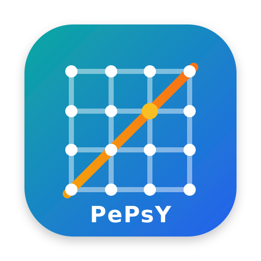

# PePsY

<p align="center">
  
</p>

**Quantum circuits. Tensor networks.**

PePsY (“PEPS in Python”) simulates quantum circuits with MPS, PEPS, tree,
and stabilizer tensor networks, with tools for optimization and sampling.

$$
\underbrace{{\color{purple}|\psi_{\mathrm{TN}}\rangle}}_{\text{tensor-network output}}
\;\approx\;
\underbrace{{\color{blue}U_m\cdots U_2 U_1}}_{\text{quantum circuit}}
\underbrace{{\color{teal}|\psi_0\rangle}}_{\text{initial state}}
$$

For unitary circuits, $U_1$ acts first; tensor-network compression controls
the approximation.

Version **0.6.0** · Python **3.12+** · [Changelog](CHANGELOG.md)

## Install

From a checkout:

```bash
python -m pip install .
```

See [installation](docs/installation.md) for setup and optional dependencies.

## Circuit simulation

Start with the **[MPS simulation notebook](examples/MpsMagnetization/mps_simulator.ipynb)**,
or choose a guide:

| Task | Guide |
| --- | --- |
| **MPS** · matrix product states | [Circuit replay and compression](docs/api/optimizers/mps.md) |
| **PEPS** · projected entangled pair states | [Gates and operator steps](docs/api/optimizers/peps.md) |
| **Tree** tensor networks | [Tree circuit replay](docs/api/optimizers/tree_replay.md) |
| **Stabilizer** tensor networks | [MPS](docs/api/optimizers/stabilizer_tn.md) and [trees](docs/api/optimizers/tree_stabilizer.md) |
| **Noise & measurements** | [Quantum trajectories](docs/api/optimizers/noise.md) |
| **Guppy** circuits | [Circuit adapter](docs/api/interop.md) |

[Documentation](docs/index.md) · [API reference](docs/api/index.md) ·
[Examples](docs/examples.md) · [Contributing](CONTRIBUTING.md)
