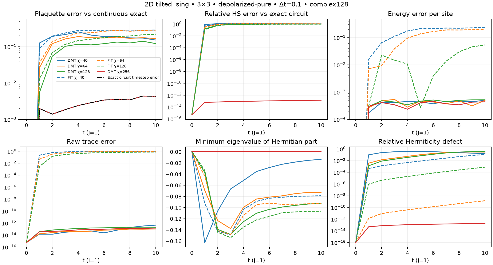

# Exact-reference 2D DMT dynamics and variational compression

This benchmark tests long finite-system trajectories on a physical square
lattice represented by an MPO. Preservation succeeds at truncated bonds even
when long-time local accuracy and positivity fail. Native loopy PEPOs and a
hard-constrained global variational fitter are not implemented by this work.

## Model and references

Open 3×2 and 3×3 lattices include **every horizontal and vertical edge**
(7 and 12 edges). With Pauli matrices and coupling/time units J=1,

$$
H=\sum_{\langle ij\rangle}Z_iZ_j
+1.05\sum_i X_i+0.5\sum_i Z_i.
$$

The snake-row-major mapping is shared by operators, gates and all physical
2×2 plaquette regions. Each edge Hamiltonian receives each endpoint's onsite
field divided by that site's degree. Their sum equals an independently
constructed bit-flip Hamiltonian. A symmetric forward/backward edge schedule
merges its identical turnaround pair; each timestep has 13 or 23 gates.
Runs use Δt=0.1 through t=10 (100 timesteps).

Local pure vectors use θ=π/2+0.35(−1)^(x+y) and
φ=0.7+0.3 cos(πx/(Lx−1)). Two initially positive families are tested:

$$
\rho_0=0.6|\psi_0\rangle\langle\psi_0|+0.4I/2^N,
\qquad |\psi_0\rangle=\bigotimes_i
\left(\cos(\theta_i/2)|0\rangle+e^{i\phi_i}\sin(\theta_i/2)|1\rangle\right),
$$

and the higher-entropy product mixed state

$$
\rho_0^{\rm mixed}=\bigotimes_i
\left(0.6I_i/2+0.4|\psi_i\rangle\langle\psi_i|\right).
$$

Continuous-time references use the full Hamiltonian's eigendecomposition.
An independent statevector follows the identical Trotter gates for the first
family; direct ket/bra tensor-axis multiplication follows the mixed density
matrix for the second. Both references preserve the exact initial spectrum.
There is no tensor-network compression in either reference.

## Compared algorithms and measurements

- **DMT:** ordinary MPO `MpoOptimizer(mode="dmt")`, strict paper truncation,
  physical plaquettes, zero cutoff, `dmt_preservation_check="warn"`.
  Full-panel runtime scans are disabled; bond/trace checks remain active.
- **FIT:** existing `MpoOptimizer(mode="dmrg")`, two-site FIT blocks,
  four sweeps per gate, RL directions, direct initialization, layered exact
  targets and zero target/output cutoffs. This baseline is unconstrained
  variational compression, not a hard-constrained DMT sweep.
- Both use NumPy CPU complex128, one BLAS thread and the same gate order and
  final bond cap. Short Torch CPU complex128 runs check the alternate backend.
  No external trace normalization, Hermitianization or positivity repair is
  applied to the evolved states. The library's own DMT trace policy is retained.

Recorded bond maxima refer to completed-step outputs; exact targets and
temporary routing can have larger bonds. A rejected budget or solver failure
is retained as a failed row rather than counted as a completed trajectory.

For requested plaquettes R, the two different errors are

$$
{\color{blue}\epsilon_{\rm gate}}=
\max_R\|\operatorname{Tr}_{\bar R}
(\rho_{j+1}-U_j\rho_jU_j^\dagger)\|_F,
\qquad
{\color{purple}\epsilon_{\rm exact}(t)}=
\max_R\|\operatorname{Tr}_{\bar R}
(\rho_\chi(t)-\rho_{\rm exact}(t))\|_F.
$$

Independent gate audits inspect every gate in timesteps 1, 50 and 100:
39 gates per 3×2 trajectory and 69 per 3×3 trajectory. The source is the
preceding **current compressed** state, including for FIT's local live state;
it is not a stale optimizer snapshot. Audits use physical ket/bra contractions
and direct gates on region/support unions, independently of protected maps.
All other steps retain normal cheap runtime checks.

Saved samples include raw trace, site XYZ errors, global relative
Hilbert–Schmidt errors against both references, plaquette errors, energy
errors per site, global Hermiticity defects, minimum global/local
Hermitian-part eigenvalues and the total negative global spectral weight.
Negative Hermitian-part eigenvalues diagnose an invalid density operator;
when Hermiticity is also lost, these spectra are explicitly not a positivity
certificate. Readout and independent audits are excluded from update timings.
Timings are single trajectory measurements, not repeated isolated speed tests.

## Completed finite-size findings

At 3×2, χ=20 is rejected by strict DMT's conservative protected budget.
No relaxed fallback or larger hidden final cap is used. At χ=64 the MPO can
represent every six-qubit operator, providing an untruncated control. Both
algorithms agree with the exact Trotter trajectory to below 10⁻¹² relative
Hilbert–Schmidt error through t=10. The remaining continuous-time plaquette
error is 0.0103288 for the depolarized pure input and 0.00249208 for the
product mixed input at Δt=0.1.

At χ=32/48, DMT's independently audited gate defects stay near roundoff,
but its long-time plaquette errors are substantial and the global operators
become indefinite. For the depolarized pure input at t=10, DMT's errors are
0.40069/0.25569, versus FIT's 0.23851/0.10250 at the same caps. For the product
mixed input they are 0.09394/0.07948, versus FIT's 0.08349/0.04847.
FIT does not preserve the gated target marginals, trace or energy. DMT keeps
energy errors much smaller here, but energy is insufficient to certify the
trajectory. More χ improves these measured local errors while positivity
need not improve monotonically.

For 3×3, DMT's t=10 plaquette errors at χ=40/64/128 are
0.15305/0.16804/0.12225. Their trapezoid-averaged errors on the sampled
0≤t≤10 trajectory are 0.18090/0.14707/0.09796. The average improves, but
the endpoint is not monotonic and none of those caps has converged to the
uncompressed circuit's timestep floor. Global Hermiticity defects are
0.16065/0.29169/0.36528 relative to the exact density's HS norm: the ordinary
complex-MPO route loses substantial Hermiticity as well as positivity.
All measured final plaquette Hermitian-part minimum eigenvalues nevertheless
exceed 0.02. Local positive panels therefore do not certify a valid global
density operator. These are limitations of the measured unconstrained
global operator representation; do not label its Hermitian-part spectrum
as the spectrum of a physical state.

A finite set of successful cases cannot establish universal long-time
accuracy or convergence in the thermodynamic limit. These small closed
lattices test finite-size trajectories, not large-lattice hydrodynamic scaling.

## Completed 3×3 comparison

For the depolarized pure input, the sampled time mean is the trapezoid
average of the maximum raw plaquette error on t=0,1,…,10:

| χ | DMT mean plaquette error | FIT mean plaquette error | DMT energy error/site at t=10 | FIT energy error/site at t=10 |
| --- | ---: | ---: | ---: | ---: |
| 40 | 0.18090 | 0.23824 | 0.00050108 | 0.23873 |
| 64 | 0.14707 | 0.20757 | 0.00050227 | 0.20017 |
| 128 | 0.09796 | 0.13994 | 0.00052318 | 0.05388 |
| 256 | 0.0027453 | not run | 0.00044098 | not run |

At **χ=256**, every nine-qubit operator fits in the MPO. The completed DMT
trajectory matches the uncompressed circuit at t=10 to 1.41×10⁻¹³ relative
HS error and 3.14×10⁻¹⁴ maximum plaquette error. Its continuous-time final
plaquette error is 0.00433075, equal to the independent Trotter error. The
global minimum eigenvalue remains 0.00078125, with Hermiticity defect
1.81×10⁻¹³. Thus this case recovers the physical untruncated answer; it does
not establish that the much cheaper χ=40–128 trajectories are converged.

DMT's sampled gate-preservation defects are at most 3.04×10⁻¹³ in this
3×3 chi sweep, including the exact-cap control. FIT defects reach about
0.0058–0.0089 at the truncated caps. Neither contract implies that its
subsequent trajectory minimizes physical observable error.

**Trace matters for the comparison.** FIT's raw final traces at χ=40/64/128
are approximately 0.07680/0.10192/0.27457. Raw RDM/HS errors above include
that normalization loss. Trace-normalizing only its energy readout gives
errors/site 0.90257/0.97615/0.68531; no evolved tensor is normalized or repaired.
The summary stores this additional diagnostic separately. This benchmark
does not compare trace-constrained FIT, real-Pauli FIT or positive purifications.

For the **product mixed 3×3 input at χ=64**, final plaquette errors are
0.0224834 (DMT) and 0.0266555 (FIT); sampled means are 0.0210241 and 0.0230618.
Energy errors/site are 0.000313089 and 0.0417385. DMT's raw trace error is
9.12×10⁻¹⁴ versus FIT's 0.0173333. Both global operators are indefinite;
DMT also has a 0.13831 relative Hermiticity defect despite positive measured
plaquette Hermitian parts. Combined with the opposite local-error ranking
on 3×2, these results support no universal winner.



[Product mixed 3×3 plot](2026-11-19-dmt-2d-dynamics-3x3-mixed.png),
[3×2 plot](2026-11-19-dmt-2d-dynamics-3x2.png),
[product mixed 3×2 plot](2026-11-19-dmt-2d-dynamics-3x2-mixed.png).
Each PNG has a sibling SVG for vector export.

The [summary JSON](2026-11-19-dmt-2d-dynamics-summary.json) retains all 27
trajectory rows (26 complete, one explicit budget rejection), six timestep
controls, six FIT-sweep controls and the backend cutoff probe. The
[CSV](2026-11-19-dmt-2d-dynamics-results.csv) contains 393 sampled rows.
Update times in JSON are measured once per trajectory; concurrent CPU jobs
and different internal schedules preclude treating their ratio as an isolated
solver speedup benchmark.

## Timestep, FIT-sweep and backend controls

For the uncompressed circuit at t=10, halving Δt gives approximately fourfold
smaller plaquette error:

| Lattice | Δt=0.1 | Δt=0.05 | Δt=0.025 |
| --- | ---: | ---: | ---: |
| 3×2 | 0.0103288 | 0.00257807 | 0.000644248 |
| 3×3 | 0.00433075 | 0.00107992 | 0.000269797 |

This floor is independent of chi. At 3×2, χ=48, t=10, FIT with 2/4/8 sweeps
gives final errors 0.1025012174/0.1025012167/0.1025012172. At 3×3, χ=64,
t=1, these are 0.0354527606/0.0354506582/0.0354503287. Four-to-eight-sweep
sensitivity is small in these controls; this is not a global optimum certificate.

Short 3×2 NumPy/Torch CPU complex128 comparisons through t=2 agree in the
reported DMT metrics to about 2×10⁻¹⁴ at χ=32/48, and in FIT metrics to
about 2×10⁻¹² at χ=48. **FIT χ=32 is backend-sensitive:** final full-density
difference is about 0.12693. The first large difference occurs at gate 7,
an adjacent central gate. An independent operator-Schmidt decomposition
of its current target has singular values s₃₂≈s₃₃≈0.000101094234,
separated by about 1.44×10⁻¹⁴ (relative gap 1.43×10⁻¹⁰).
This is consistent with different retained subspaces at a nearly degenerate
cutoff and subsequent variational evolution; exact-cap checks pass on both
backends. It does not justify blanket NumPy/Torch trajectory equivalence or
identify a proven backend bug. The comparison uses the existing ordinary
complex-MPO FIT route, not an explicitly Hermiticity-constrained fitter.

## Reproduce

Activate the repository-selected environment first. From the repository root:

```bash
python examples/dmt_2d_dynamics.py --shape 3 2 --chis 20 32 48 64 \
  --steps 100 --sample-every 5 --methods dmt fit --output /tmp/dmt-2d-3x2.json
python examples/dmt_2d_dynamics.py --shape 3 3 --chis 40 64 128 \
  --steps 100 --sample-every 10 --methods dmt fit --output /tmp/dmt-2d-3x3.json
python examples/dmt_2d_dynamics.py --shape 3 3 --chis 256 --steps 100 \
  --sample-every 10 --methods dmt --output /tmp/dmt-2d-exact-cap.json
python examples/dmt_2d_dynamics.py --shape 3 2 --chis 32 48 64 \
  --initial-kind product-mixed --steps 100 --sample-every 5 \
  --methods dmt fit --output /tmp/dmt-2d-mixed.json
python examples/dmt_2d_dynamics.py --shape 3 3 --chis 64 \
  --initial-kind product-mixed --steps 100 --sample-every 10 \
  --methods dmt fit --output /tmp/dmt-2d-3x3-mixed.json
python examples/dmt_2d_dynamics.py --shape 3 2 --chis 32 48 --steps 20 \
  --sample-every 5 --methods dmt fit --backend torch --output /tmp/dmt-2d-torch.json
python examples/dmt_2d_dynamics.py --plot-only /tmp/dmt-2d-3x3.json \
  --output /tmp/dmt-2d-3x3.png
```

Use `--fit-sweeps` for the variational sweep-count check. `--methods optimized`
selects the existing optional **local** bond refiner; it does not enable a
global constrained DMRG method.

## Validation and compatibility

The focused selection passed **161 tests**: new benchmark/reference tests,
DMT refinement, ordinary MPO replay and Pauli lattice tests. The new checks
cover independent field/edge counting under three mappings, second-order
timestep error, exact mixed-density evolution, exact-cap replay and audit
consistency, lossy preservation versus accumulated error, budget rejection,
visible raw normalization/Hermiticity defects and Torch complex128 retention.
After the readout-only energy contraction/normalization fields and CLI failure
recording were finalized, the 12 benchmark tests were rerun. Ruff, individual
skill/catalog checks, local links and whitespace checks pass. No full-suite
claim; the preceding task's installed-package version mismatch was not changed.
No production solver or public numerical default changed.

Installed versions/signatures were rechecked and unchanged from the
[DMT API audit](2026-11-19-dmt-check-api.md): NumPy 2.5.2, SciPy 1.18.0,
Quimb 1.15.0, Autoray 0.8.4, Cotengra 0.8.3.dev8+g8954240f2,
Cotengrust 0.2.1, Symmray 0.4.1.dev15+g0374aaa3c and Torch 2.9.1.
The same task's official upstream audit is reused; Symmray's array-doc URL
was unavailable. **Adopt:** benchmark the existing public DMT/FIT routes with
independent references. **Defer:** new constrained global FIT integration,
native PEPO evolution, dependency upgrades and symmetry/GPU claims.
