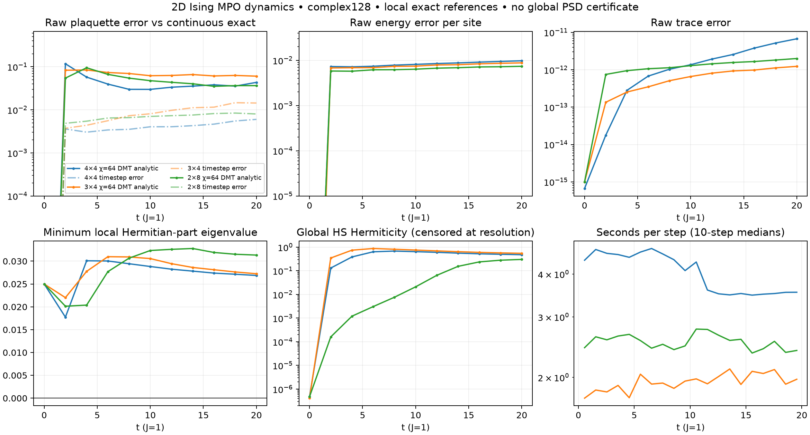
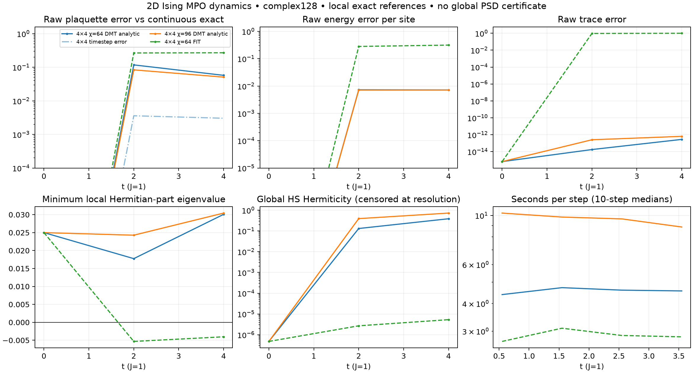

# 4×4 and rectangular MPO dynamics: sparse references and runtime

The 2D benchmark now reaches 16 spins without a dense global density matrix.
It measures local accuracy, preservation and runtime separately; global
positivity remains unverified and substantial Hermiticity loss is observable.
This is an MPO representation of physical lattices, not native PEPO evolution.

## Model, shapes and references

Use the same Pauli Hamiltonian and depolarized pure input family as the
[smaller-lattice study](2026-11-19-dmt-2d-dynamics.md):

$$
H={\color{blue}\sum_{\langle ij\rangle}Z_iZ_j}
+1.05\sum_iX_i+0.5\sum_iZ_i,
\qquad \rho_0=0.6|\psi_0\rangle\langle\psi_0|+0.4I/2^N.
$$

| Shape | Spins | Physical edges | Plaquettes | Maximum MPO edge span |
| --- | ---: | ---: | ---: | ---: |
| 2×8 | 16 | 22 | 7 | 3 |
| 3×4 | 12 | 17 | 6 | 5 |
| 4×4 | 16 | 24 | 9 | 7 |

All horizontal/vertical edges are included. Snake-row-major storage and
`region_selection="min_cover"` are explicit. The protected inventory consists
of physical 2×2 plaquettes. Output caps are checked after every timestep;
temporary exact targets can have larger bonds.

A 16-spin complex128 statevector needs 1 MiB; its global density would need
64 GiB before workspace. The new reference path builds only a sparse bit-flip
Hamiltonian, propagates a statevector with `expm_multiply`, and obtains local
matrices as 0.6 times the pure-state marginal plus 0.4 times the local identity.
An independent statevector follows the identical Trotter circuit. Reference
cache keys include the Hamiltonian, edges, initial vector, timestep and sample
schedule. Dense small-system tests check both paths independently.

The scalable Strang schedule is

$$
U_{\Delta t}\approx
e^{-iA\Delta t/2}\,{\color{purple}e^{-iB\Delta t}}\,e^{-iA\Delta t/2},
\quad A=\sum_i(1.05X_i+0.5Z_i),\quad B=\sum_{\langle ij\rangle}Z_iZ_j.
$$

Onsite rotations are exact physical-index operations and do not grow bonds.
The MPO applies each ZZ edge then compresses. The reference multiplies by the
exact product diagonal of all commuting ZZ gates. This is a different
second-order schedule from the previous forward/backward distributed-field
edge schedule; its timestep error is checked separately. Main trajectories
use Δt=0.1 through t=20; the χ=96 and FIT 4×4 controls extend through t=5.
Samples every two time units in the long runs do not resolve every transient.

## Exact target construction and update variants

Three existing-compressor workflows are compared:

- **Routed:** ordinary `MpoOptimizer(mode="dmt")` gate-stream replay,
  retaining its local/routed workspace within each timestep.
- **Generic full sweep:** one public replay call per dense gate, forcing a
  complete protected sweep of each exact target.
- **Analytic full sweep:** construct the Ising gate without factorization,
  multiply the MPO exactly, then call public `compress_mpo_dmt`.

$$
e^{-i\theta Z_iZ_j}=
{\color{blue}\cos\theta\,I}-{\color{purple}i\sin\theta\,Z_iZ_j}.
$$

This operator has an exact rank-two MPO, so conjugation enlarges bonds on the
affected interval by at most four. There is no operator-factorization cutoff.
On a rank-two 4×4 input and the physical edge stored at (0,7), the generic
target's largest stored bond is 32 versus 8 for the analytic target. All nine
target plaquettes agree to 6.34×10⁻¹⁶. This verifies the target, not equality
of subsequent truncated trajectories across different gauges/update orders.

In the initial χ=64, min-cover pilot, the second timestep costs approximately
35.85 s for generic full sweeps, 10.98 s routed, and 4.03 s analytic full sweeps.
Generic/analytic full sweeps share the compression rule and physical target;
finite-precision factorization choices can still select different truncated
subspaces. Routed and full sweeps also have different compression orders.
These pilot timings are not a bitwise-equivalent algorithm speedup claim.

All runs use NumPy complex128, one BLAS thread, zero target/output cutoffs,
strict constraints and warn-and-record preservation checks. No positivity,
Hermiticity or trace repair is applied. Independent gate audits run at the
first, middle and final timestep, outside update timing. FIT uses the existing
unconstrained two-site, four-sweep ordinary MPO implementation.

## Diagnostics and performance interpretation

Raw and trace-normalized plaquette errors, site XYZ errors, energy, trace,
local Hermiticity and local Hermitian-part minimum eigenvalues are measured
against exact references. Normalization affects only a separate readout;
the evolved operator is unchanged. Full global eigenvalues are **not computed**.
A positive local panel is not a global positivity certificate.

Global HS norm/Hermiticity uses double-MPO contractions:

$$
\|\rho-\rho^\dagger\|_{\rm HS}^2
=2\|\rho\|_{\rm HS}^2-2\operatorname{Re}\operatorname{Tr}(\rho^2).
$$

The overlap difference is cancellation-limited near zero. Saved results
include a resolution estimate; plots censor sub-resolution values at that
floor. The relative defect divides by the current MPO's HS norm. The method
does not estimate global positivity or global error against
the exact 16-spin density. `global_min_eigenvalue=None` means unmeasured.

The separate 4×4 χ=64 profile covers timestep 2, with profiling overhead
excluded from ordinary timing comparisons. Native QR and truncated SVD account
for about 2.22 s and 1.61 s of its 6.28 s profiled update. These disjoint native
factorization routines account for about 61% of that wall time. Complete DMT
compression is 5.52 s, including those calls; nested cumulative times must not
be added. Further gains primarily require less decomposition/canonicalization
work; dropping more outer verification does not address the measured bottleneck.

Per-step times exclude independent readout/audits/reference preparation and
checkpoint I/O. They include exact fields, state-copy/bookkeeping and target
construction. Plots use medians over up to ten timesteps. Process peak RSS
includes references and temporary tensors; stored MPO bytes are also recorded.
Several one-thread jobs ran concurrently, so timings are observational rather
than isolated, repeated hardware speed measurements.

## Completed long-time results

All three analytic-target χ=64 runs completed 200 timesteps through t=20.
Error means maximum raw plaquette Frobenius error against continuous-time
exact evolution. Steady cost is the median after the first ten timesteps.

| Shape | χ | Error at t=20 | Uncompressed timestep error | Median seconds/step | Process peak MiB |
| --- | ---: | ---: | ---: | ---: | ---: |
| 2×8 | 64 | 0.036496 | 0.008018 | 2.536 | 550 |
| 3×4 | 64 | 0.060598 | 0.014403 | 1.951 | 510 |
| 4×4 | 64 | 0.043448 | 0.006008 | 4.080 | 667 |

Update totals are 508.69/390.35/813.90 seconds. Stored MPOs occupy
2.63/1.63/2.63 MiB; process peaks include references and temporary targets.
Reference vector norm defects remain below 8.5×10⁻¹⁴ and energy drift below
3.1×10⁻¹⁴ per site. Audited preservation defects stay below 3.16×10⁻¹⁴:
66/51/72 two-site gates are audited for 2×8/3×4/4×4. There are no recorded
preservation violations. The 4×4 run records three native SVD fallbacks to
GESVD, which complete successfully.

**Physicality still fails.** Final trace errors are
2.00×10⁻¹²/1.23×10⁻¹²/6.74×10⁻¹² for 2×8/3×4/4×4, but global relative
Hermiticity defects are 0.304/0.551/0.479. Final local Hermitian-part minimum
eigenvalues remain positive: 0.03133/0.02725/0.02687. These panels do not
certify valid global density operators. Ordinary complex-MPO truncation
does not enforce global Hermiticity or PSD; subsequent gates can move
unprotected/discarded information into local observables.



### Higher chi and FIT on 4×4

χ=96 completes through t=5 at a 9.29-second steady median, with final
plaquette error 0.041454 and global Hermiticity defect 0.799. One native SVD
fallback is recorded. The χ=64 long run samples every two time units, so
**t=4** is the latest common stored sample for comparison:

| Method | χ | Raw plaquette error at t=4 | Trace-normalized error | Global Hermiticity defect |
| --- | ---: | ---: | ---: | ---: |
| Analytic-target DMT | 64 | 0.057506 | 0.057506 | 0.387 |
| Analytic-target DMT | 96 | 0.050919 | 0.050919 | 0.725 |
| Ordinary FIT | 64 | 0.269927 | 0.980376 | 5.33×10⁻⁶ |

Larger chi modestly improves this local error while worsening global
Hermiticity. FIT completes through t=5 at a 2.89-second steady median, but
its final trace is about 0.01076 and its local Hermitian part has a negative
eigenvalue. Raw/trace-normalized final plaquette errors are 0.27016/1.16160.
No normalization is applied during evolution; this does not rank all
variational methods or establish a converged physical long-time solution.



The comparison plot uses common stored readouts at t=0,2,4; markers show
measured samples. Per-step performance curves use all unprofiled steps to t=4.

### Routing, budget and timestep controls

The 3×4 routed χ=64 run reaches t=20 with error 0.060562 versus 0.060598
for analytic full sweeps, and median costs 3.12 versus 1.95 seconds/step.
Similar endpoint errors do not prove equal trajectories; see the
[update-order plot](2026-11-19-dmt-2d-scaling-update-order.png).
Routed χ=32 on 2×8 reaches t=20 with error 0.046274 at 0.594 seconds/step.
On 4×4, χ=32 is rejected in both routed and generic-full pilots: bond 3
requires a conservative protected budget of 41. That is not a mathematical
infeasibility proof. No hidden cap increase or relaxed fallback is used.

Uncompressed circuit errors at t=20 decrease approximately fourfold when
the timestep is halved, independently of DMT:

| Shape | Δt=0.1 | Δt=0.05 | Δt=0.025 |
| --- | ---: | ---: | ---: |
| 2×8 | 0.00801813 | 0.00201929 | 0.000505436 |
| 3×4 | 0.0144033 | 0.00361502 | 0.000902550 |
| 4×4 | 0.00600840 | 0.00147657 | 0.000367152 |

The [raw JSON](2026-11-19-dmt-2d-scaling-summary.json) retains 14 trajectory
rows (12 completed, two budget rejections), target-rank evidence, the profile
and nine timestep controls. The
[readout CSV](2026-11-19-dmt-2d-scaling-results.csv) has 85 samples;
the [timing CSV](2026-11-19-dmt-2d-scaling-steps.csv) has 1,113 attempted
steps, including marked profiled/failed attempts. Each PNG has a sibling SVG.

## Reproduce

Activate the repository-selected environment, then:

```bash
python examples/dmt_2d_scaling.py --shape 4 4 --chis 64 --steps 200 \
  --sample-every 20 --update analytic --region-selection min_cover \
  --reference-cache /tmp/dmt-4x4-t20-refs.npz --output /tmp/dmt-4x4.json
python examples/dmt_2d_scaling.py --shape 2 8 --chis 64 --steps 200 \
  --sample-every 20 --update analytic --region-selection min_cover \
  --output /tmp/dmt-2x8.json
python examples/dmt_2d_scaling.py --shape 3 4 --chis 64 --steps 200 \
  --sample-every 20 --update analytic --region-selection min_cover \
  --output /tmp/dmt-3x4.json
python examples/dmt_2d_scaling.py --shape 4 4 --chis 96 --steps 50 \
  --sample-every 10 --update analytic --region-selection min_cover \
  --output /tmp/dmt-4x4-chi96.json
python examples/dmt_2d_scaling.py --shape 4 4 --chis 64 --steps 50 \
  --sample-every 10 --methods fit --output /tmp/dmt-4x4-fit.json
python examples/dmt_2d_scaling.py --shape 4 4 --chis 64 --steps 3 \
  --sample-every 1 --update analytic --region-selection min_cover \
  --profile-step 2 --output /tmp/dmt-4x4-profile.json
python examples/dmt_2d_scaling.py --plot-only /tmp/dmt-4x4.json \
  /tmp/dmt-2x8.json /tmp/dmt-3x4.json --output /tmp/dmt-shapes.png
```

`--references-only` produces reference diagnostics/cache without MPO evolution.
The sparse path supports only the stated depolarized pure family, not arbitrary
full-rank mixed inputs. `--max-seconds` is an explicit update-time budget
checked between timesteps; a budget-limited row is not marked completed.

## Validation and compatibility

Focused larger/smaller 2D benchmark, DMT refinement, ordinary replay and Pauli
lattice selection: **176 passed**, with one existing QR rank-policy warning.
Tests cover sparse/dense Hamiltonian equality, absence of a global 4×4 density,
rank-two ZZ targets, nonsymmetric complex onsite action, cache rejection,
second-order error, full/routed/analytic exact-cap reconstruction and actual
lossy compression with preserved gated marginals. No production solver changed.

After final benchmark-only readout/CLI/plot additions, the two example test
modules passed **27 tests**. Ruff and local-link/whitespace checks pass.
No full-suite or alternate-device claim is made.

Official Quimb/Autoray/Cotengra/Symmray sources were checked; Symmray's
array-doc URL remains unavailable. Installed versions are unchanged from
the [preceding audit](2026-11-19-dmt-check-api.md). Public MPO `apply` and
physical-index gate signatures were inspected in installed Quimb 1.15.0.
**Adopt:** sparse/local oracles and exact analytic Ising targets in the
benchmark. **Defer:** production hybrid update integration, native PEPOs,
approximate decompositions, dependency upgrades and GPU claims.
