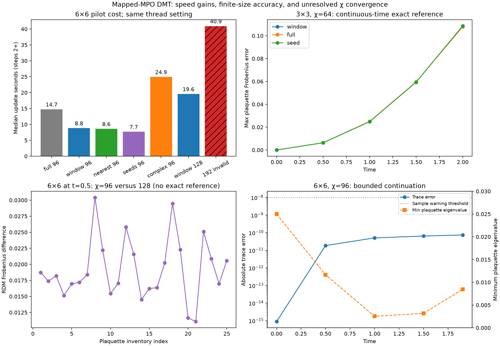

# Real-Pauli interval DMT on 6×6

**Prototype:** reusing the canonical workspace and compressing the gate's
affected interval improves measured runtime. Real Pauli coefficients enforce
Hermiticity. Neither change establishes positivity or converged 6×6 dynamics;
χ=192 exposes unresolved numerical failures and native process faults.



## Implemented scope

[The example](../../../examples/dmt_2d_window.py) uses the same initial
product-state/identity mixture and open-boundary Ising Hamiltonian as the
[4×4 study](2026-11-19-dmt-2d-scaling.md):

$$
H=\sum_{\langle ij\rangle}Z_iZ_j+1.05\sum_iX_i+0.5\sum_iZ_i,
\qquad \rho_0=0.6|\psi_0\rangle\langle\psi_0|+0.4I/2^N.
$$

Every physical edge is included: 60 edges and 25 protected plaquettes on
6×6. Snake-row-major mapping determines MPO positions. Strang steps apply
exact field rotations, every commuting ZZ gate, then the field rotations
again; dt=0.1. No 36-site statevector or global density is allocated.

- **Interval compression:** a private workspace helper applies a physical
  transfer MPO, exactly QR-canonicalizes its interval and DMT-splits its
  affected bonds. Existing outside gauges, geometry plans and trace
  environments are reused. The next gate uses a copied workspace; a raised
  exception cannot commit its partial update to the previous workspace.
- **Real Pauli coefficients:** conjugation by the Ising gate has an exact
  real rank-four transfer MPO. Field rotations use real Pauli transfer
  matrices. float64 retains double precision for each real coefficient;
  physical RDMs and the control run use complex128.
- **Alternative schedules:** full versus interval sweeps, fixed versus
  nearest-endpoint edge order, and `truncation="optimized"` with zero
  alternating-refinement sweeps are explicit experimental choices.
- **Verification:** finite preservation failures warn and are recorded.
  Full panel scans stay outside timed updates. The final interval helper
  adds a fresh scalar trace contraction before/after compression, independent
  of cached protection vectors. Public optimizer entry points/defaults are
  unchanged; this is not an integrated nonlocal `PauliDMT` API.

For Hermitian Pauli words,

$$
\rho=\sum_\mu {\color{purple}c_\mu}P_\mu,\qquad
{\color{purple}c_\mu\in\mathbb R}\ \Longrightarrow\ \rho=\rho^\dagger.
$$

This structural statement gives no positive-semidefinite guarantee. Exact
canonical gauges are still required for the stated Hilbert–Schmidt objective;
the optimization reuses and limits gauge work rather than eliminating it.

## Measured cost and accuracy

Pilot medians below use completed steps 2 onward. These runs share the same
unset Apple Accelerate thread setting; `threadpoolctl` does **not** control
Accelerate here. They must not be mixed with later VECLIB-limited timings.
Some checks/diagnostics ran concurrently, so these are observations rather
than isolated repeated scaling measurements.

| 6×6 case | Completed endpoint | Median update seconds | Stored cores MiB |
| --- | --- | ---: | ---: |
| Real full sweep, χ=96 | t=0.3 | 14.74 | 8.32 |
| Real interval, χ=96 | t=0.5 | 8.82 | 8.32 |
| Real interval, nearest order, χ=96 | t=0.5 | 8.58 | 8.32 |
| Real interval, optimized seeds, χ=96 | t=0.3 | 7.68 | 8.32 |
| Complex interval, χ=96 | t=0.3 | 24.92 | 16.63 |
| Real interval, χ=128 | t=0.5 | 19.56 | 14.57 |
| Real interval, χ=192, **invalid trace** | t=0.5 | 40.91 | 32.32 |

The conservative χ=64 construction rejects a 65-direction protected budget
before finishing a timestep. The optimized-seed control also rejects this
case; neither rejection proves mathematical infeasibility at χ=64.

A separately bounded χ=96 continuation, with `VECLIB_MAXIMUM_THREADS=1`,
completes 19 steps to t=1.9 before its soft 240-second update budget is
checked. Updates total 250.07 s, median 13.40 s; five readouts total 0.24 s.
Endpoint trace error is 7.45e-11, minimum plaquette eigenvalue 0.00847,
and local Hermiticity defect zero. Global positivity is unmeasured.

**Accuracy is not converged:** at t=0.5 the maximum plaquette difference
between χ=96 and 128 is 0.03042. Neither is an exact reference, and the
invalid χ=192 output cannot be a reference. For the exactly checkable
commuting ZZ-only model, χ=96 has maximum plaquette error 0.08927 at t=0.5
despite trace error 3.48e-10 and energy conservation near roundoff.

The independent 3×3 continuous-time reference uses a sparse Hamiltonian and
statevector. All rows below use χ=64, t=2 and the same gate schedule:

| Compression schedule | Median step seconds | Max exact plaquette error | Global minimum eigenvalue |
| --- | ---: | ---: | ---: |
| Full | 0.583 | 0.10790 | −0.12244 |
| Interval | 0.413 | 0.10863 | −0.12394 |
| Interval, nearest edge | 0.405 | 0.10913 | −0.12314 |
| Interval, optimized seeds | 0.217 | 0.10868 | −0.12394 |

Thus optimized seeds offer the best tested speed tradeoff here, with similar
local errors, but do not fix global positivity. No variational-optimum or
universal speed/accuracy claim follows from these finite samples.

## Independent preservation and final profile

A positive mixture of 128 independent product states is actually compressed
to χ=96 on 6×6. Directly summing local product densities gives maximum
plaquette defect 3.32e-15 and trace defect 7.55e-15. A separate dynamical
audit after the t=1.9 trajectory applies a long gate between sites 0 and 11;
all 25 post-compression plaquettes agree with that gate's exact current
target within 1.17e-14. Neither audit compares a truncated trajectory with
the exact many-body trajectory.

A final-code χ=96 timestep profile takes 13.97 s:

| Disjoint profiled stage | Seconds |
| --- | ---: |
| Native Quimb QR driver | 4.27 |
| Native Quimb SVD driver | 6.81 |
| Fresh scalar trace guards, 120 contractions | 0.165 |

QR/SVD account for about 79%; fresh scalar checking accounts for 1.2%.
Protection-vector construction is a separate 0.94 s. Disabling these cheap
trace checks would not address the main cost.

## Unresolved χ=192 failure

The original five-step run has trace error 1.23 and minimum plaquette
eigenvalue −1.36. A captured failure has canonical-isometry defect 4.86,
versus roughly 1e-14 on ordinary neighboring cores. Some related processes
terminate with native SIGTRAP/SIGSEGV/SIGABRT/SIGBUS faults. These outputs
are unusable as physical benchmarks.

Controls using full sweeps, Quimb's batched decomposition route, explicit
Accelerate thread limiting, Torch float64, and the `smallest` region rule
do not establish a fix. In particular, the final `smallest` control records
trace failures and subsequently exits with SIGSEGV. The precise cause is
**unresolved**; it has not been isolated to a particular library or algorithm.
Do not present this as an inevitable DMT positivity limitation or a resolved
backend bug. The new scalar guard detects finite trace loss but cannot make
a native process fault continue safely. Last completed checkpoints survive.

## Practical recommendation and reproducibility

Use the real-Pauli interval **prototype** to reduce cost and enforce
Hermiticity; test optimized seeds without alternating sweeps before paying
for local ALS iterations. Keep χ-convergence and small exact references
alongside preservation checks. Generic unconstrained Quimb FIT/zip-up
compression is not a replacement for the protected split. Native loopy
PEPOs need a separate algorithm and analysis.

If guaranteed positivity is required, a locally purified representation
changes the problem: [Werner et al.](https://arxiv.org/abs/1412.5746) guarantee
positivity in their 1D scheme, but preserving DMT's linear RDM constraints
in purification factors is a separate nonlinear optimization problem.
No purification implementation or 2D guarantee is claimed here.

Run from the repository root in the selected environment:

```bash
VECLIB_MAXIMUM_THREADS=1 python examples/dmt_2d_window.py \
  --shape 6 6 --chi 96 --steps 20 --sample-every 5 \
  --max-seconds 240 --output /tmp/dmt6-window96-long.json
python examples/dmt_2d_window.py --chi 96 --truncation optimized \
  --steps 3 --output /tmp/dmt6-seeds.json
MPLBACKEND=Agg python examples/dmt_2d_window.py \
  --plot-summary docs/development/notes/2026-11-19-dmt-2d-window-summary.json \
  --output /tmp/dmt-window-figure
```

[Aggregate records](2026-11-19-dmt-2d-window-summary.json),
[case table](2026-11-19-dmt-2d-window-results.csv),
[readouts](2026-11-19-dmt-2d-window-samples.csv), and
[individual step times](2026-11-19-dmt-2d-window-steps.csv) retain invalid
cases and timing-setting distinctions. The SVG accompanies the PNG.

Final validation: **301 focused DMT/regression tests pass**, including all
22 interval tests, with eight existing Torch rank-policy/Quimb warnings.
Ruff, the mathematical probe, skill catalog, local links and whitespace
checks pass. This is not a full-suite, GPU, or native PEPO validation.
