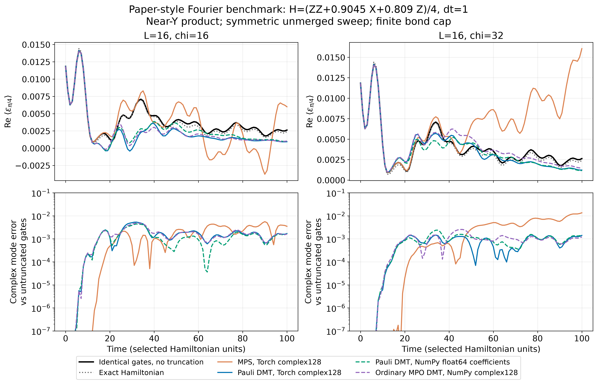

# DMT precision, positivity, and paper-style Ising benchmarks

**Later figure audit:** the [Fig. 7/8 comparison](2026-11-19-dmt-white-figures.md)
resolves the convention mismatch below against digitized curves, reproduces
the L=16 semiexact reference, and records the remaining L=64 DMT failures.
The explicit-equation experiments here precede that recovered protocol.

**Measured:** Torch complex128 does not remove DMT negativity. Independent
gate-by-gate contractions locate the first negative local target *before*
compression. Paper-style larger-step experiments favor Pauli DMT over MPS
at the tested equal bond caps, unlike the earlier small-step comparison.
These are explicit-equation benchmarks, not a verified reproduction of the
published curves.

## Precision and scope

The [earlier experiment](2026-11-19-dmt-ising-dynamics.md) used NumPy
complex128 for MPS and ordinary MPO, and complex128 or float64 for native
Pauli coefficients. It did not include long Torch runs.

This follow-up runs Torch 2.9.1 on CPU with **complex128 gates and cores**
for MPS direct, ordinary MPO DMT, and native Pauli DMT. The example asserts
the final core and gate dtypes. Neither CUDA nor the Torch MPS device is
available in this environment. GPU execution and gradients are not claimed.
No production DMT rule, tolerance, or precision guard was changed.

The benchmark explicitly registers the public Torch stop-gradient helper
before MPS evolution. A fresh-process run originally exposed a missing
Autoray dispatch that an earlier Pauli-DMT import had hidden in the small
combined tests. A subprocess regression now checks standalone startup.
MPS readout uses independently contracted transfer environments rather than
a dense whole-chain vector; a complex, nontrivial-gauge, scaled-state test
compares it with dense partial traces.

## Why protected local matrices can become negative

For each contiguous three-site region R, the truncation contract is

$$
\widetilde\rho_{n+1}=\mathcal T_\chi(U_n\widetilde\rho_nU_n^\dagger),
\qquad
{\color{blue}\operatorname{Tr}_{\bar R}\widetilde\rho_{n+1}}
=\operatorname{Tr}_{\bar R}(U_n\widetilde\rho_nU_n^\dagger).
$$

The right-hand side uses the **current approximate full operator**. DMT
does not impose its positive semidefiniteness. A truncation can change a
four-site or larger density while preserving every three-site matrix.
A later gate crossing a three-site boundary makes that region depend on
the four-site input. Its exact post-gate target can consequently be negative.
Preserving that target does not restore positivity.

An independent dense L=6 diagnostic, chi=16, dt=0.05, near-Y tilted Ising:

| Event | Before gate | After gate and compression | Triple preservation defect |
| --- | ---: | ---: | ---: |
| First global eigenvalue below -1e-9 | -2.28e-14 | -6.63e-8 | 7.28e-16 |
| Minimum triple eigenvalue at that event | -1.63e-15 | -1.71e-15 | same event |

The first event occurs at step 2, gate index 6, bond 2–3 (zero-based).
Unitary gating preserves global eigenvalues, so the global negativity here
arises in compression, while the protected triples remain positive to
roundoff. At step 3, gate index 3, the relevant four-site input has minimum
eigenvalue -2.58e-7. The gated triple target has minimum -2.32735e-8;
the compressed triple agrees within 4.37e-16.

At L=16, Torch complex128, chi=16, the first triple eigenvalue below -1e-9
appears at step 2, gate index 23, bond 5–6. The input four-site density
has minimum -3.28e-8; the post-gate target and compressed triple both have
minimum approximately -1.00992e-9, with a 1.82e-15 preservation defect.
The largest preservation defect through those 53 gates is 5.57e-14.
Full L=16 eigenvalues were not computed. The analogous NumPy real-Pauli
trace also passes preservation while showing the same mechanism.

Thus this negativity is **not evidence of a violated three-site preservation
contract**. It is a physical limitation of the approximation. Later negative
eigenvalues can be appreciable; they should not be dismissed as roundoff.
Ordinary complex MPO evolution additionally loses Hermiticity in these
tests, a separate limitation that is absent in the native Pauli runs here.

[White et al., Sec. IV B near Fig. 5](https://arxiv.org/pdf/1707.01506)
explicitly distinguish their purity/normalization diagnostic from positive
semidefiniteness. Their DMT scheme has no general positivity guarantee.
Their Fig. 5 tests chi=64–512; our smaller caps are not a quantitative
replication of that figure.

## Long Torch complex128 comparison at the earlier small timestep

L=16, chi=16, dt=0.05, t=20, samples every 0.5, same gates and exact
Hamiltonian reference as the earlier report. Entries are all-site XYZ RMSE.

| Model | MPS direct | Ordinary MPO DMT | Native Pauli DMT |
| --- | ---: | ---: | ---: |
| TFIM, hx=1.05, hz=0 | 0.05845 | 0.12116 | 0.11794 |
| Tilted, hx=0.9045, hz=0.809 | 0.03351 | 0.06388 | 0.06557 |

For tilted Pauli DMT, maximum energy drift per site is 2.59178e-4 versus
MPS's 2.73465e-2; minimum sampled triple eigenvalue is -0.05965. Its
Hermiticity defect is zero. Ordinary MPO DMT's maximum triple Hermiticity
defect is 0.2658. All six trajectories complete, with actual lossy DMT
splits, verified double precision and strict native guards. Each DMT run
also independently audits twelve gates across the trajectory.

## Comparison using the paper's energy Fourier observable

The earlier cosine mode was not precisely the paper's complex Fourier mode.
The example now also measures the Eq. (35) PDF observable, with one-based j:

$$
{\color{blue}\epsilon_{\pi/4}}
=-\frac1L\sum_{j=1}^{L-1}e^{i\pi j/4}\epsilon_j.
$$

All new paper-style runs use the Eq. (32) normalized near-Y product state,
both separately compressed turnaround half gates from Appendix A, t=100,
dt=1 in the stated convention, and samples every step. The reference is an
independent **untruncated identical-gate state vector**, isolating compression
error as in Fig. 8. Continuous-Hamiltonian references are also retained.
RMS errors below include all 101 times and the absolute complex mode error.

Taking the printed Hamiltonian's S=Pauli/2 interpretation gives

$$
H_{1/2}=\frac14\left[\sum ZZ+0.9045\sum X+0.8090\sum Z\right].
$$

These runs use dt=0.25, t=25 in the example's Pauli-J=1 coordinates; the
following energy errors are divided by four to give the displayed units.

| chi | Torch MPS complex128 | Torch Pauli DMT complex128 | NumPy real-Pauli DMT | NumPy ordinary MPO DMT |
| --- | ---: | ---: | ---: | ---: |
| 16 | 2.3052e-3 | 2.0196e-3 | 1.6506e-3 | 1.9463e-3 |
| 32 | 4.8696e-3 | 8.5980e-4 | 1.0268e-3 | 1.0836e-3 |

At chi=32, Torch Pauli DMT gives about **5.7 times smaller** mode RMSE
than Torch MPS. All-site XYZ RMSE against the continuous Hamiltonian is
0.02571/0.01587 for Pauli DMT at chi=16/32, versus 0.08736/0.05002 for
MPS. This improves on MPS in this protocol; it does not invalidate the
opposite ordering at the smaller timestep. Neither protocol establishes
a converged joint timestep/bond-dimension limit.

The Pauli minimum triple eigenvalues here are -0.01330 at chi=16 and about
-5.03e-13 at chi=32. Good Fourier accuracy and positivity are separate checks.



For the alternative literal S=Pauli interpretation, the printed equation is
H=ΣZZ+0.45225ΣX+0.4045ΣZ. A second Torch complex128 experiment uses that
Hamiltonian directly, dt=1, t=100:

| chi | MPS mode RMSE | Pauli DMT mode RMSE |
| --- | ---: | ---: |
| 16 | 1.7155e-2 | 6.8213e-3 |
| 32 | 2.7001e-2 | 6.0592e-3 |

[Alternative-convention plot](2026-11-19-dmt-complex128-paper-pauli.png).
These larger-step simulations have visible Trotter error: for example, the
untruncated stream's XYZ RMSE against the continuous Hamiltonian is 0.03817
in this second convention. Comparing to the gate reference avoids labeling
that common error as compression error.

### Published-curve reproduction remains unverified

The printed near-Y equation with S=Pauli/2 gives initial total energy
0.0132424 at L=64; the published Fig. 7 curve starts near 0.3. This mismatch
must be resolved before identifying either explicit-convention experiment
with the authors' plotted data. No author code or raw data was available
in the downloaded arXiv source. We do not assign a cause to the mismatch.

An attempted L=64, chi=16, dt=0.0625, t=40 energy test in the S=Pauli/2
convention completes MPS, but **Pauli DMT fails at step 3, gate 60, bond
60–61**: relative trace defect 1.21e-6 exceeds the existing 4.77e-7 guard.
A separate replay reproduces the failure. The guard is not disabled, and
the partial MPS result is not presented as a successful comparison. This
is an unresolved numerical conditioning/trace-preservation failure,
distinct from DMT's lack of a positivity guarantee.

## Artifacts, validation, and reproduction

- [Complete summary and configurations](2026-11-19-dmt-complex128-summary.json):
  25 reference/method rows, three first-negativity traces, and the L=64 failure.
- [CSV](2026-11-19-dmt-complex128-results.csv) retains raw Pauli-coordinate
  errors; apply the stated quarter factor for the first convention's energy.
  Figures are also available as SVG alongside the PNGs.
- Focused MPO replay/MPS/normalization/gate-precision/benchmark selection:
  **269 passed, one skipped**. Final example regressions and Ruff are recorded
  in the session handoff. No full-suite success is claimed.
- One CPU/BLAS thread per run; some independent jobs ran concurrently.
  Timings are not a controlled speed comparison. No dependencies were changed.

Activate the repository-selected environment before running:

```bash
python examples/dmt_ising_dynamics.py --backend torch --models tfim tilted \
  --chis 16 --methods mps-direct mpo-dmt pauli-dmt --time 20 \
  --sample-every 10 --output /tmp/dmt-ising-l16-torch
python examples/dmt_ising_dynamics.py --backend torch --models tilted \
  --chis 16 32 --methods mps-direct pauli-dmt --dt .25 --time 25 \
  --sample-every 1 --unmerged-turnaround --output /tmp/dmt-ising-paper-l16-torch
python examples/dmt_ising_dynamics.py --backend torch --models paper-pauli \
  --chis 16 32 --methods mps-direct pauli-dmt --dt 1 --time 100 \
  --sample-every 1 --unmerged-turnaround --output /tmp/dmt-ising-paper-pauli-l16-torch
python examples/dmt_positivity_diagnostic.py --backend torch --complex
python examples/dmt_positivity_diagnostic.py --length 6 --chi 16
```

Raw NPZ trajectories and first-event density matrices remain under the
corresponding `/tmp/dmt-*` paths. All changes remain uncommitted.
