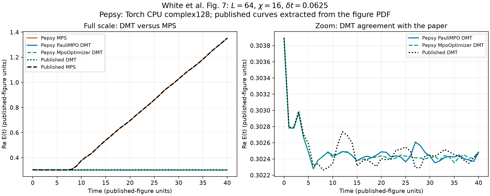

# Direct L=64 comparison with the paper

**Measured:** Pepsy reproduces the nearly flat DMT energy and strongly
drifting MPS energy in [White et al., Fig. 7](https://arxiv.org/pdf/1707.01506).
This compares published numerical curves with completed L=64 runs, rather
than using guard thresholds as a benchmark.

[SVG](2026-11-19-dmt-l64-paper-comparison.svg),
[plotted values](2026-11-19-dmt-l64-paper-comparison.csv), and
[metrics](2026-11-19-dmt-l64-paper-comparison.json).

## Same figure protocol

L=64, chi=16, figure timestep 0.0625 and final time 40, with the recovered
near-Y figure state and unmerged turnaround gates. Pepsy uses Torch CPU
complex128. The [convention record](2026-11-19-dmt-white-figures.md#independent-recovery-of-the-figure-conventions)
defines the Hamiltonian, initial state and spin/Pauli unit conversion.
Published values come from the PDF vector curves, not original simulation
files. Only the final exported x=39 endpoint is aligned to t=40; the raw
fixture is unchanged. RMSE uses the 40 common published sample times.

| Method | Re E(40), figure units | Max sampled real-energy drift | RMSE versus corresponding published curve |
| --- | ---: | ---: | ---: |
| Published DMT | 0.30248171 | 0.00162735 | — |
| Pepsy PauliMPO DMT | 0.30248211 | 0.00161018 | 0.00011593 |
| Pepsy MpoOptimizer DMT | 0.30249049 | 0.00161341 | 0.00009346 |
| Published MPS | 1.35252676 | 1.04863498 | — |
| Pepsy MPS | 1.35136771 | 1.04747594 | 0.00023813 |

All initial energies are approximately 0.303891775. At the endpoint, native
Pauli DMT differs from published DMT by 3.95e-7, and ordinary MPO's real
energy differs by 8.78e-6. Our DMT energy drift is about 650 times smaller
than our MPS drift at the same bond cap. The paper's DMT curve itself has
a small finite-step drift on this zoomed scale.

The ordinary MPO run skips full-region verification while retaining bond
checks and develops Im E(40)=-1.1524e-4; its table entries compare real
energies. Both DMT trajectories continue in warning mode. Their known
trace/nonpositivity defects are recorded in the
[separate diagnostics report](2026-11-19-dmt-preservation-policy.md).
Agreement for this total-energy observable does not validate all local
observables or the full density operator.

Fig. 8 is a different benchmark at L=16,20,24; it contains no published L=64
reference curve. The direct L=64 comparison requested here is Fig. 7.

## Validation

Recomputed metrics from saved complex128 trajectories and checked the 40
comparison times exactly. The focused PNG was visually inspected. No
simulation kernel or numerical method changed for this comparison, and no
trajectories were rerun. Files remain uncommitted.
