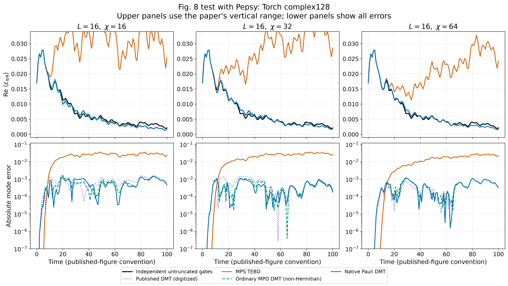
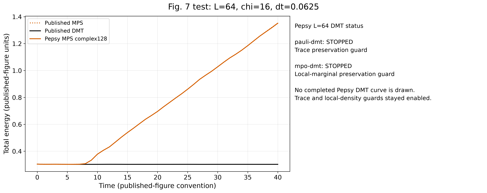

# Pepsy comparison with White et al. Figs. 7 and 8

**Measured:** the L=16 Fig. 8 untruncated reference is reproduced to
3.26e-9 against digitized PDF coordinates. Native Pauli DMT gives 31–48
times smaller energy-mode RMSE than MPS TEBD at chi=16/32/64. At L=64,
both DMT paths stop at existing preservation guards, so Fig. 7 is a
**failed DMT benchmark**, with a successful MPS baseline.

Subsequent [warning-mode continuations](2026-11-19-dmt-preservation-policy.md)
complete the Pauli trajectories and quantify the actual precision loss and
nonpositivity. The strict-policy failures below remain valid.

This supersedes the unresolved convention discussion in the
[earlier precision report](2026-11-19-dmt-complex128-positivity.md).
Those earlier explicit-equation experiments remain valid, but they were
not the published-figure protocol recovered here.

## Independent recovery of the figure conventions

Source: [White et al., arXiv:1707.01506v2](https://arxiv.org/pdf/1707.01506),
Figs. 4, 7 and 8. The arXiv source contains vector PDFs, not raw simulation
files. The [extraction script](../../../examples/extract_white2018_figures.py)
recovers their numerical line coordinates; the [fixture](../../../examples/data/white2018_figures.json)
retains the original plotted times, source filenames and coordinate-error scale.

The curves select the following empirical mapping to our Pauli-coordinate
benchmark. This is an inference checked against the reference trajectory,
not a claim about the authors' unavailable implementation.

$$
{\color{blue}H_P}=\sum ZZ+0.9045\sum X+0.8090\sum Z,
\qquad
{\color{purple}t_P=t_{\rm fig}/2},\qquad E_{\rm fig}=\langle H_P\rangle/4.
$$

The normalized initial site vectors are

$$
|\phi_j\rangle=
\frac{-i(1+g_j)|0\rangle+(1-g_j)|1\rangle}
{\sqrt{2(1+g_j^2)}}.
$$

Here g=-0.1 at one-based j mod 8 in {1,2,7,0}, and +0.1 otherwise.
This has positive Y orientation and balanced spin polarization
Sz=±0.09900990099. At L=64 its initial energy is 0.3038917753, matching
Figs. 4 and 7. `--initial near-y-figure` selects it; `near-y` still selects
the literal printed Eq. (32), and `near-y-balanced` retains the negative-Y
balanced variant used during the convention investigation.

For the Fig. 8 ordinate, the PDF data use the real part of the zero-based
Fourier phase:

$$
{\color{blue}\epsilon_{\rm fig}}
=\frac14\operatorname{Re}\!\left[e^{-i\pi/4}
\left(-\frac1L\sum_{j=1}^{L-1}e^{i\pi j/4}\epsilon_{P,j}\right)\right].
$$

The sweep retains both turnaround half gates. The digitized PDFs place the
last endpoint state at x=99 in Fig. 8 and x=39 in Fig. 7. Aligning those
single samples to t=100 and t=40, respectively, makes the independent
untruncated Fig. 8 trajectory agree with **all 100 published reference
samples** to 3.2537e-9. Without that endpoint alignment the last reference
point differs by 1.91e-4; it matches our t=100 state to 7.7e-10. The raw
fixture is unchanged, and the alignment is explicit in the comparison script
and summary. All preceding time coordinates remain as printed.

The initial mapping was checked with eight early samples and then validated
over the complete trajectory. The agreement is with the paper's semiexact
MPS chi=256 curve at L=16, using an independent dense state-vector gate
reference. Continuous-Hamiltonian results are also saved; they are not used
to assign Trotter error to compression.

## Fig. 8: completed L=16 runs

Torch 2.9.1 CPU, complex128 gates and tensor storage, cutoff=0, strict
protection, default connected-residual paper truncation. Figure time runs
0–100 with dt=1; the example uses Pauli time 0–50 and dt=0.5. MPS uses
both `svd` and `direct`; their aggregate mode RMSEs agree within 6.6e-11.

The table uses RMS **real Fourier-mode error** against the untruncated gate
reference on the same 100 aligned published sample times. The broader
all-site XYZ errors from earlier reports measure a different quantity.

| chi | MPS TEBD | Ordinary MPO DMT | Native Pauli DMT | Published DMT, digitized |
| --- | ---: | ---: | ---: | ---: |
| 16 | 2.4488e-2 | 7.3285e-4 | 7.2701e-4 | 8.4480e-4 |
| 32 | 2.2698e-2 | 5.4092e-4 | 4.7333e-4 | 7.0573e-4 |
| 64 | 1.6257e-2 | 5.2412e-4 | 5.1840e-4 | 4.6275e-4 |

Native Pauli DMT improves on MPS by **33.7x, 48.0x and 31.4x**,
respectively. Its accuracy is comparable to the published DMT curves;
the results do not establish superiority over the authors' implementation.
Equal bond caps are not equal execution-cost budgets.



**Physical and numerical checks:**

- Every completed method ends at the requested bond cap and retains
  complex128. All twelve method/cap trajectories complete.
- Across six DMT runs, 72 selected gates are independently audited against
  their own exact gated targets. Maximum triple preservation defect is
  1.37e-15; maximum total-energy jump due to compression is 5.71e-15 in
  raw Pauli-H units. Native guards remain active on other updates.
- Maximum sampled trace drift across methods is 1.89e-12.
- Pauli DMT Hermiticity defects are zero in these runs. Its most negative
  sampled three-site eigenvalues are -0.01447 at chi=16 and roundoff
  (approximately -2.5e-16) at chi=32/64. Global positivity is not certified.
- Ordinary complex MPO DMT has maximum triple Hermiticity defects
  0.0141/0.0160/0.0131 for chi=16/32/64. Its good mode RMSE does not clear
  this separate limitation; the plot labels that path as non-Hermitian.

Only L=16 was evolved for this exact-reference comparison. The fixture
also contains the authors' L=20/24 curves, which are not Pepsy simulations.

## Fig. 7: MPS completes; Pepsy DMT fails its guards

L=64, chi=16, figure dt=0.0625, t=40. The MPS baseline uses the same
recovered state/time conventions and Torch complex128. Initial energy
matches to digitization precision. Maximum difference from the published
MPS energy curve is 1.26e-4 through t=30 and 1.16e-3 over the full plotted
range. The corrected endpoint is included in these comparisons.

The DMT attempts do not complete:

| Path | Observed failure |
| --- | --- |
| Torch Pauli DMT | Step 2, gate index 60, bond 60–61: relative trace defect 5.28e-7 exceeds 4.77e-7 |
| Torch ordinary MPO DMT | Local-marginal window 23: scaled defect 1.83e-12 exceeds 1.82e-12 |
| NumPy ordinary MPO DMT cross-check | Window 22: scaled defect 1.86e-12 exceeds 1.82e-12 |

Short Torch Pauli chi=32/64 probes also stop at trace guards. The ordinary
MPO failures are barely above their numerical thresholds; these errors do
not by themselves establish a large physical error. They do prevent a
validated full Fig. 7 DMT trajectory with the current implementation.



The long-chain pure operator has weak identity contractions relative to
its canonical norm. Temporary probes of basis choice, sweep direction and
trace-aware refactorization did not satisfy the independent physical-density
audits consistently. They remain under `/tmp`; **none was adopted into
production DMT**. No guard, tolerance or bond cap was relaxed. A stable
long-chain constrained factorization remains unresolved.

## Artifacts and reproduction

- [Summary, configurations and diagnostics](2026-11-19-dmt-white-summary.json).
- [Fig. 8 results CSV](2026-11-19-dmt-white-results.csv).
- PNG and SVG figures accompany this note. Original trajectory NPZs remain
  under `/tmp/pepsy-white-fig8-l16-torch` and `/tmp/pepsy-white-fig7-torch`.
- New validation: **18 benchmark regressions passed**, including the
  published spin/energy initialization and independent Fig. 8 reference.
  Ruff, local report links and whitespace checks pass. Earlier 269-test
  focused results belong to the preceding work; no new full-suite claim.
- One CPU/BLAS thread per run, with some independent tasks concurrent.
  Timing is not a controlled speed benchmark. No dependencies changed.

Activate the repository-selected environment, then:

```bash
python examples/dmt_ising_paper_energy.py --backend torch \
  --methods mps-direct pauli-dmt mpo-dmt --sample-every 16 \
  --output /tmp/pepsy-white-fig7-torch
# The Fig. 7 command exits nonzero after recording both DMT failures.

python examples/dmt_ising_dynamics.py --backend torch --models tilted \
  --initial near-y-figure --dt .5 --time 50 --sample-every 1 \
  --unmerged-turnaround --chis 16 32 64 \
  --methods mps-svd mps-direct mpo-dmt pauli-dmt \
  --output /tmp/pepsy-white-fig8-l16-torch

python examples/dmt_white_figures.py \
  --fig7-input /tmp/pepsy-white-fig7-torch \
  --fig8-input /tmp/pepsy-white-fig8-l16-torch \
  --output /tmp/pepsy-white-comparison
```

To recover the reference fixture again, download the arXiv source archive
and run `extract_white2018_figures.py --source ARCHIVE --output OUTPUT`.
The optional pypdf dependency is needed only for this extraction. Everything
remains uncommitted; the production DMT implementation is unchanged by this
figure-comparison follow-up.
