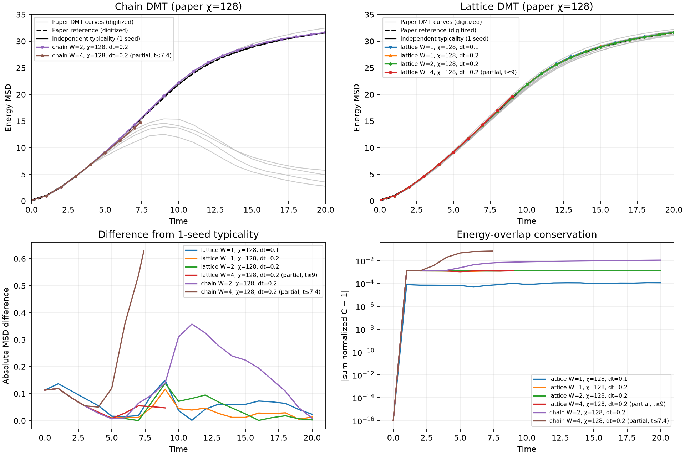

# Fig. 2 energy-transport comparison

This benchmark compares Pepsy's protected-SVD evolution with the physical
energy-transport test in [Anand et al., Fig. 2](https://arxiv.org/pdf/2610.40776).
It is a selected-width comparison, not a reproduction of every published curve
or of the authors' TDVP implementation.

Working tree on `develop`, baseline `eaedf789`; earlier DMT changes preserved.
CuPy/CUDA and positive-factor fitting are outside this task.

## Physics and normalization

Use open chains of length 21 with transverse/longitudinal fields 1.4/0.9045
and no interchain coupling. Sites are interleaved column by column,
`j=x*width+y`; physical horizontal edges span `width` MPO positions. The paper
uses chi128 and compares chain/lattice DMT against Krylov/typicality data.
Our evolution uses Strang field/ZZ/field transfers, whereas theirs uses TDVP.

$$
{\color{blue}H}=\sum_{x,y}\left(1.4X_{x,y}+0.9045Z_{x,y}\right)
+\sum_{x=0}^{19}\sum_y Z_{x,y}Z_{x+1,y}.
$$

The initial **traceless operator** is the middle column's energy density,
including half of each adjacent horizontal bond. Define

$$
h_x=\sum_y\left(1.4X_{x,y}+0.9045Z_{x,y}
+\tfrac12 Z_{x-1,y}Z_{x,y}+\tfrac12 Z_{x,y}Z_{x+1,y}\right),
\qquad {\color{purple}O(t)}=e^{iHt}h_{10}e^{-iHt}.
$$

Drop bonds outside the open lattice. Measure

$$
C_x(t)=2^{-N}\operatorname{Tr}(h_xO(t)),\quad
\widetilde C_x(t)=\frac{C_x(t)}{W(1.4^2+0.9045^2+1)},\quad
{\color{blue}\mathrm{MSD}}=\sum_x\widetilde C_x(x-10)^2
-\left[\sum_x\widetilde C_x(x-10)\right]^2.
$$

The denominator is the analytic **initial** total overlap, not the measured
time-dependent weight. This leaves conservation errors visible. Initially
`MSD=0.5/(1.4**2+0.9045**2+1)=0.13234094`. Positivity is not a requirement on
this traceless observable; density-DMT denominators are not used.

## Implementation and references

- [Benchmark](../../../examples/dmt_lattice_fig2.py): public `PauliDMT`,
  `variant="operator"`, real Pauli float64 Torch storage/contractions;
  explicit CPU SciPy GESDD/pivoted QR, exact transfer MPOs and cutoff zero.
  Complex128 is independently tested on the exact small circuit.
- Lattice protection explicitly contains all straight and L-shaped three-site
  paths of the full square geometry, including vertical paths at zero vertical
  coupling. Chain protection uses the default contiguous storage triples.
  `min_cover` gives maximum static string counts 8/14/26/62/122 for widths
  1/2/4/10/20, matching the linear construction budget. This is not a measured
  numerical-rank or convergence certificate, nor an assertion of identical
  per-cut projectors to the paper.
- The independent single-chain reference uses a sparse bit-basis Hamiltonian
  and random-phase typicality, propagating a pair of length-2**21 vectors
  through SciPy exponential actions. No 21-spin density matrix is formed.
  One random state has unestimated sampling uncertainty; it is not labeled
  exact. Dense spectral calculations on small chains validate continuous-time
  and identical-circuit observables separately.
- [Digitized fixture](../../../examples/data/lattice_dmt_fig2.json) contains
  vector polylines extracted from the published PDF, not raw author data.
  The [extractor](../../../examples/extract_lattice_dmt_fig2.py) checks its
  layout and stores the source PDF hash. Coordinate rounding is about 3e-4
  in MSD; curve simplification/interpolation and the source typicality error
  are separate and unquantified. The plotted reference starts at 0.17456,
  unlike the analytic 0.13234; this offset is not attributed to DMT.
  The source archive contains TeX and figure PDFs, with no raw numerical
  series; its Fig. 2 timestep is not specified. The isotropic-cylinder and
  Heisenberg timestep descriptions are not silently assigned to this test.

Preservation failures warn and are recorded. A numerical factorization failure
cannot produce a next state. Large runs use fast checks; full per-gate panel
verification is exercised by independent small lossy/exact tests. Alternating
whole sweep directions is part of the declared finite-chi schedule. This
schedule need not produce the same finite-chi trajectory as TDVP.

## Measured results

The [aggregate](2026-11-20-dmt-lattice-fig2-results.json) retains all parameters,
sampled correlators/MSDs, total-weight defects, failures and timing data.
Runtimes overlap other processes, so they do not establish isolated speedups.
Soft CPU evolution budgets are checked between complete timesteps and exclude
initialization, independent readout and reference construction.

The completed width-one chi128 controls give MSD(20)=31.66191 at dt=0.1 and
31.62494 at dt=0.2. Their maximum sampled difference is 0.08897; the endpoint
difference is 0.03697. The published plotted Krylov/typicality endpoint is
31.58286. These are agreements between numerical datasets, not a certified
sub-percent error bound on exact dynamics.

Width-two lattice DMT completes t=20 at dt=0.2, giving MSD=31.63558. Its
endpoint difference from the matched-dt width-one result is 0.01064 (0.034%).
Across all integer sample times, their maximum absolute difference is 0.04834.
The maximum sampled total-overlap defect is 0.0014224; no preservation warning
is recorded. The overlap defect includes evolution error and is distinct from
preservation of each current post-gate target during truncation.

The independent 21-spin, seed712 reference starts at MSD=0.24570 and total
weight=1.001141 instead of the analytic 0.13234 and 1. This exposes stochastic
trace-estimation noise. Its total weight stays constant during propagation;
the discrepancy is not hidden by renormalization. It reaches MSD=21.9400
at t=10. More random states would be needed for defensible statistical bars.
The independent reference completes t=20 at MSD=31.6384. Its close endpoint
agreement with lattice DMT does not remove the single-state statistical limit.

At the common width-four sample t=7:

| Calculation | MSD | Measured total overlap |
| --- | --- | --- |
| Chain DMT, dt0.2 | 13.73422 | 0.932142 |
| Lattice DMT, dt0.2 | 14.32772 | 0.998723 |
| Independent single-chain typicality | 14.27268 | 1.001141 |

The geometry-dependent separation appears at the same chi and timestep.
Chain DMT's physical energy terms span distant storage positions and need
not belong to its protected chain inventory. It can therefore lose physical
energy overlap while satisfying every constraint it actually requests.
Lattice protection targets those physical terms and their current supports.
The remaining lattice overlap drift includes time-integration error.

The width-four chain run stops after a complete timestep at t=7.4 under its
1500-second evolution budget: MSD=14.71624 and overlap=0.930837. It is a
partial-time comparison, not a completed t=20 width-four reproduction.
The width-four lattice run reaches t=9.0 at its 1800-second budget:
MSD=19.64849 and overlap=0.998696, with no preservation warnings. The
actual update totals are 1514.0 seconds (chain) and 1814.8 seconds (lattice).

Width-two chain DMT also completes t=20: MSD=31.62926 and overlap=0.988817,
versus lattice DMT's 31.63558 and 0.998596. Similar endpoint MSDs alone hide
the larger intermediate-time and conservation defects in the chain control.
All six DMT runs finish without preservation warnings; four complete their
requested time and two stop at explicit CPU budgets. The larger published
widths and the full width-four t=20 trajectory were not run.



Gray curves are digitized published DMT data, colored curves are Pepsy runs,
and black curves are the two independently generated reference datasets.
Budget-limited colored curves are labeled with their actual ending time.

## Reproduction

Activate the repository's selected environment first:

```bash
VECLIB_MAXIMUM_THREADS=1 OPENBLAS_NUM_THREADS=1 python examples/dmt_lattice_fig2.py \
  --width 2 --chi 128 --dt .2 --time 20 --max-seconds 1500 \
  --output /tmp/fig2-width2.json

VECLIB_MAXIMUM_THREADS=1 OPENBLAS_NUM_THREADS=1 python examples/dmt_lattice_fig2.py \
  --width 4 --chi 128 --dt .2 --time 20 --protection chain --max-seconds 1500 \
  --output /tmp/fig2-chain4.json

VECLIB_MAXIMUM_THREADS=1 OPENBLAS_NUM_THREADS=1 python examples/dmt_lattice_fig2.py \
  --typicality --length 21 --time 20 --seeds 712 \
  --output /tmp/fig2-reference.json
```

Use `--protection lattice` for physical paths. Increase the explicit budget
to complete wider cases on faster machines; a partial run is retained and
labeled with its actual endpoint. `--summarize <run.json> ... --reference
<reference.json> --output <prefix>` saves JSON, PNG and SVG comparisons.
These JSON files retain observables, not resumable MPO states. This finite,
open 21-site-chain comparison does not extract a thermodynamic diffusion constant.

## Validation and scope

The focused selection has 49 passes: new physics/normalization/reference tests,
public interval tests and existing 2D-window controls. It checks nonconsecutive
physical edges, exact operator conjugation in both double-precision dtypes,
continuous-time second-order convergence, sparse bit-Hamiltonian actions and
digitization calibration. Ruff and whitespace checks pass. No core library
API changed in this benchmark follow-up; the full suite was not rerun.

Remaining distinctions: stochastic reference uncertainty, time integrator and
dt, finite-chi evolution order, and widths beyond the actual endpoints shown.
A visually good MSD is evidence for that transport observable, not a claim
that every local density matrix or higher-order correlator is converged.
