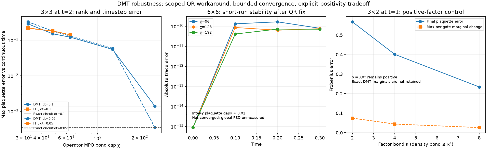

# DMT robustness, planning and positive-factor controls

The large-chi failure is reproducible outside DMT as native real-QR heap
corruption. A scoped exact workaround restores the tested 6×6 run; this does
not establish long-time convergence or positivity of DMT.

Baseline: `develop` at `eaedf789`, retaining the preceding uncommitted
[region review](2026-11-20-dmt-region-review.md). The ordered
[workstream](../plans/dmt_robustness.md) distinguishes implementation from
remaining research. Results are working-tree changes, not a published release.



## 1. Isolate and avoid the corrupting QR route

A new 6×6, chi192 diagnostic reproduced trace loss and exit 139. Monitoring
previous factor arrays caught a 768×768 QR call changing an unrelated live
768×192 factor by Frobenius norm 9.056. Immediate QR reconstruction/Gram
checks could pass before the unrelated write was noticed. Disabling Numba
JIT did not fix trace loss.

A small synthetic control, independent of DMT, repeatedly factors a real
768×768 rank-96 matrix while retaining earlier factors. Both Quimb QR and
plain NumPy QR can print successful checks and then segfault during process
cleanup. This matches the reported Accelerate `dgeqrf` heap overrun in
[NumPy issue 33161](https://github.com/numpy/numpy/issues/33161). This evidence
identifies an upstream route; it does not prove every historical native fault
has that same cause.

**Compatibility shim:** on macOS 26 arm64 with NumPy reporting Accelerate,
managed DMT/native Pauli QR routes use
[SciPy pivoted QR](https://docs.scipy.org/doc/scipy/reference/generated/scipy.linalg.qr.html)
for float32/64 matrices with a dimension at least 544. Pivoting selects
GEQP3; the column permutation is absorbed into the companion factor. These
are exact reduced factors, not a rank approximation. The companion factor
need not remain triangular. Small/complex arrays and other backends retain
their routes. A one-time warning exposes the change. No global Quimb, Autoray,
installed-library or environment registration is modified. Raw Quimb and
other optimizers' QR calls are outside this shim.

The gate schedule, model and real-float64 input are those of the
[existing interval benchmark](2026-11-19-dmt-2d-window.md). New 6×6 results
through t=0.3, dt=0.1:

| Chi | Final trace error | Recorded preservation failures |
| --- | --- | --- |
| 96 | 7.92e-11 | none |
| 128 | 7.55e-11 | none |
| 192 | 7.12e-11 | none |

All processes exited cleanly. Independently scanning every final chi192
canonical Gram gives maximum defect 6.21e-14, versus 4.86 in the historical
bad checkpoint. The minimum final chi192 plaquette eigenvalue is 0.02264;
global positivity is unmeasured. At t=0.3, maximum plaquette differences are
0.01005 for chi96/128 and 0.01110 for chi128/192: **not converged**.

## 2. Reduce exact-update overhead

When a zero-cutoff pair fits the cap and split diagnostics are disabled,
construct only the trace directions needed by the exact factorization's
guards. Full region maps cannot add preservation to an exact update.
Density denominators, finite/trace checks and requested full-panel checks
remain. Lossy updates still construct every selected protection direction.

A matched complex128 eight-site exact gated pair, six-spin protection,
cap256, occupied initial mixture rank48, eight timed alternating repetitions
after warm-up gave:

| Region selection | Before / after ms | Speedup |
| --- | --- | --- |
| min_cover | 14.676 / 13.163 | 1.11× |
| rank_aware | 22.562 / 12.979 | 1.74× |

Outputs are bitwise equal. These are bounded operation timings with
`VECLIB_MAXIMUM_THREADS=1`, not a general entangling-2D speedup. Some other
validation ran concurrently. Unchanged lossy QR/SVD costs still dominate
larger dynamics. The interval helper remains private; generic nonlocal public
Pauli replay and broader interval promotion need further work.

## 3. Cache geometry, recompute numerical ranks

Rank-aware selection now compiles physical strings, candidate covers and
column indices into immutable plans. Workspaces retain the latest plan per
visited cut. A changed routed region inventory replaces that entry, bounding
the cache by chain length. Copies own separate dictionaries, sharing only
immutable plans. Unused initial min-cover plans are no longer computed for
rank-aware workspaces or temporary routed splits.

Projected vectors, numerical protected bases, SVD support and candidate
scores remain live-state calculations. No numerical F map crosses a tensor
write or gauge move. The candidate search/rank objective and tie-breaking are
unchanged. Tests check reuse, remapping, copy isolation and fresh/cached
direction equality; rank-aware low-cap preservation regressions still pass.

## 4. Make support coverage explicit

`pepsy.operators.complete_dmt_regions(nsites, regions, required=supports)`
returns maximal explicit site sets covering both inputs. It validates all
requests before removing contained ones. Overlapping parents do not imply
their union. This is a coverage helper, not a globally optimal region search.

On 4×4, all nine plaquettes already cover L-shaped triples. Requiring all
straight triples adds sixteen requests, for 25 maximal regions. For the
16-site family $(i,i+1,i+2,i+5,i+6,i+7)$, adding all consecutive triples/pairs
adds no constraints. Tests include snake/row-major mappings and invalid sites.

## 5. Separate rank, timestep and method errors

[The new comparison](../../../examples/dmt_convergence.py) runs identical
physical-edge circuits for ordinary DMT, four-sweep unconstrained FIT with
direct initialization, and MPS. It uses the previous tilted-field Ising
model and depolarized-product input, with independent continuous-time and
untruncated-circuit references. Storage is complex128; final time is fixed
at 2 while dt is 0.1/0.05. Failed rows retain their status and never count as
final-time accuracy data.

On 3×3, maximum plaquette Frobenius errors against continuous time at dt=0.1:

| Chi | DMT | FIT |
| --- | --- | --- |
| 32 | 0.28853 | 0.22098 |
| 48 | 0.15150 | 0.17996 |
| 64 | 0.12180 | 0.14203 |
| 128 | 0.05511 | not run |
| 256 | 0.001394 | not run |

At chi256, DMT agrees with the identical circuit to numerical precision;
the maximum plaquette discrepancy is 1.37e-14 at dt=0.1 and 2.33e-14 at
dt=0.05. Continuous-time errors are 0.0013936 and 0.00034796, respectively:
the expected roughly fourfold second-order timestep convergence. At small
fixed chi, halving dt can
increase trajectory error because it also increases the number of lossy
compressions. Global negativity remains at intermediate chi even as local
error decreases. Per-gate preservation audits are separate from these
trajectory errors.

MPS caps 32/48/64 are all untruncated for the nine-spin pure component, whose
maximum wavefunction bond is 16. Its density is formed as the same analytical
identity mixture. This is a useful reference for this special family, not a
general mixed-state MPS solver comparison or equal-storage comparison. Equal
numeric MPS/MPO caps have different meanings. FIT is one explicit solver
configuration; no globally optimal variational comparison is claimed.

The 3×2 controls likewise reach the exact circuit at MPO chi64. Chi24 DMT
budget rejections remain failed rows. Smaller-chi FIT can lose trace and
positivity; those diagnostics are retained rather than normalized away.
Large 6×6 convergence is still unresolved despite the native-QR workaround.

## 6. Positive-factor research control

[The separate prototype](../../../examples/dmt_positive_factor.py) represents

$$
{\color{blue}\rho=XX^\dagger},\qquad
\operatorname{bond}(X)\le\kappa,\qquad
\operatorname{bond}(\rho)\le\kappa^2.
$$

It stores X as an MPS with local system/ancilla dimension 2×2 and truncates
the factor after physical unitary gates. Normalization changes the factor's
scale, not its positivity. Exact rank-two initialization reproduces the same
depolarized-product density without a global matrix. NumPy complex128,
one-/two-site unitaries, and small dense audits are implemented. It is not
integrated into public DMT APIs, a Kraus-evolution implementation, or a native
PEPO method. The factor representation follows the positivity principle in
[Werner et al.](https://arxiv.org/abs/1412.5746); their complete algorithm and
trace-norm bounds are not implemented here.

On 3×2 at t=1, dt=0.1:

| Kappa | Density bond ceiling | Max final plaquette error | Minimum global eigenvalue | Largest per-gate target-marginal change |
| --- | --- | --- | --- | --- |
| 2 | 4 | 0.56758 | 4.09e-4 | 0.07454 |
| 4 | 16 | 0.40135 | 2.38e-5 | 0.04418 |
| 8 | 64 | 0.23407 | 3.82e-5 | 0.02628 |

All sampled densities are positive to numerical precision and trace one.
The measured marginal changes demonstrate the tradeoff: **factor compression
does not retain DMT's exact marginals**. This is a control, not an accuracy
improvement claim over DMT. Enforcing

$$
{\color{purple}\operatorname{Tr}_{\bar S}(XX^\dagger)
=\rho_{\mathrm{target},S}}
$$

at bounded factor bond remains a nonlinear constrained optimization project.
If a requested target marginal is itself nonpositive, no PSD global state
can match it exactly, at any bond dimension. No silent clipping/repair is added.

## Validation and reproduction

The 558-case DMT selection passes (one skipped, eight existing warnings).
Native Pauli algebra/compression adds 128 passes, one skip and one existing
JAX complex-gradient warning. After the final platform-gating checks, the
42-case new-feature selection passes. Full-suite execution stops at the same
BP cluster test on both this tree and an archived clean `eaedf789`: 104 pass,
seven skip, then `test_loopunion_selects_both_plaquettes_and_clips_at_edge`
fails because an Autoray Torch namespace receives a NumPy array. Public API/
layout selection still has the existing installed 0.5.0 versus checkout 0.6.0
metadata mismatch. No installed metadata was changed.

Activate the repository-selected environment and run, for example:

```bash
VECLIB_MAXIMUM_THREADS=1 python examples/dmt_2d_window.py \
  --shape 6 6 --chi 192 --steps 3 --sample-every 1
VECLIB_MAXIMUM_THREADS=1 python examples/dmt_convergence.py \
  --shape 3 3 --chis 32 48 64 --dts .1 .05 --final-time 2
VECLIB_MAXIMUM_THREADS=1 python examples/dmt_convergence.py \
  --shape 3 3 --chis 128 256 --dts .1 .05 --final-time 2 --methods dmt
VECLIB_MAXIMUM_THREADS=1 python examples/dmt_positive_factor.py \
  --shape 3 2 --kappas 2 4 8 --steps 10
python examples/dmt_convergence.py \
  --plot-summary docs/development/notes/2026-11-20-dmt-robustness-results.json \
  --output /tmp/dmt-robustness-figure
```

The [aggregate results](2026-11-20-dmt-robustness-results.json) retain full
comparison rows, failed cases and short-run stability evidence. Raw large
checkpoints/probes stay in temporary storage. No full-suite, GPU, long-time
6×6 convergence, or simultaneous PSD/exact-marginal guarantee is claimed.
