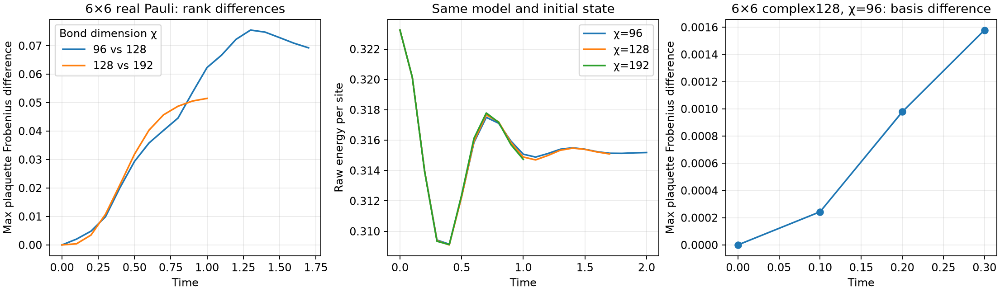

# Torch DMT interval integration and physical 6×6 tests

Public exact interval maps now work in both ordinary `MpoOptimizer` and native
`PauliDMT`. Longer CPU tests distinguish factorization failures from finite-chi
trajectory error. **6×6 convergence is not established.**

Baseline: `develop`, `eaedf789`; working-tree changes, preserving the earlier
[robustness study](2026-11-20-dmt-robustness.md). CuPy is deferred by the user.
The positive-factor/XX† direction is outside this workstream.

## Physics and coordinates

Open 6×6 square lattice, 36 spin-1/2 sites, Pauli operators with eigenvalues
±1, J=1 and ℏ=1:

$$
{\color{blue}H}=\sum_{\langle ij\rangle}Z_iZ_j
+1.05\sum_iX_i+0.5\sum_iZ_i,\qquad
{\color{purple}\rho_0}=0.6|\psi_0\rangle\langle\psi_0|+0.4I/2^{36}.
$$

There are 60 physical edges and 25 elementary plaquettes. The product state
has local spinor `(cos(theta/2), exp(i*phi)*sin(theta/2))`, with
`theta=pi/2+0.35*(-1)**(x+y)` and `phi=0.7+0.3*cos(pi*x/5)` for x,y=0,…,5.
Positive ZZ coupling is antiferromagnetic in this convention. Both fields
are present: this is a tilted-field Ising quench, not zero-longitudinal-field
TFIM. The identity part remains stationary under exact unitary evolution.

Snake-row-major mapping stores this physical lattice in an open MPO. Every
plaquette's joint four-spin marginal is protected; its subsets include all
Hamiltonian terms. The gate schedule includes every physical edge. It uses
field-half / commuting-ZZ-layer / field-half Strang steps, dt=0.1, with exact
rank-four conjugation transfer maps spanning distant storage positions.
Field maps are exact one-site actions; no global density or statevector is
allocated for 36 sites.

| Representation | Local stored coordinates | Precision tested |
| --- | --- | --- |
| Ordinary MPO / `MpoOptimizer` | Matrix units `|s><t|`, fused `(ket,bra)` | Torch complex128 |
| Native `PauliMPO` / `PauliDMT` | Raw `I,X,Y,Z` coefficients | Torch complex128; separately labeled float64 controls |

The coordinate change is exact and local. Complex degenerate truncations can
select different approximations across bases. Real Pauli coefficients enforce
Hermiticity, but do not enforce positivity. CPU timings below ran concurrently
with other validation and are not isolated speed measurements.



## Implemented API and checks

- Public `apply_transfer_mpo` in both drivers; exact post-action target before
  lossy splitting, interval/full controls, nearest-end or fixed direction.
- Reuse canonical cores and environments without buffer hashes or numerical
  gauge scans. Static candidates remain separate from dynamic protection maps.
- Transactional state/metadata/report commits. Ordinary uncached oversized
  inputs are capped after applying the map, including spectator bonds.
- Strict full-panel checks once per update when requested; cheap replay defaults
  retain bond/trace guards. One-site actions skip duplicate trace contractions
  while retaining finite and resolved-density guards.
- Additive `update_errors` retains warnings even without bond splits.
  Finite failed preservation checks warn, continue and are recorded. Failed
  factorizations and native faults cannot yield a usable next state.

See the [ordinary API](../../api/optimizers/mpo.md#exact-interval-transfer-maps)
and [Pauli API](../../api/optimizers/pauli_dmt.md#exact-interval-transfer-mpos).
This does not change `.run()` gate-stream routing or add automatic 2D scheduling.
Full per-gate region verification is disabled in the large runs; independent
readout contracts raw trace and all plaquettes at sampled timesteps.

## CPU numerical controls

Installed Torch 2.9.1 reports Apple Accelerate BLAS/LAPACK; CUDA is unavailable.
NumPy 2.5.2, SciPy 1.18.0, Quimb 1.15.0 and Autoray 0.8.4 were used.
The earlier NumPy-specific shim does not intercept Torch.

A captured finite complex128 128×128 residual (norm 0.4706) makes raw
`torch.linalg.svd` return nonfinite factors. Both SciPy drivers reconstruct
it to about 8e-16 or better. Long native real controls also exhibit large
preservation loss; one exits 139. Replacing only SVD still permits later
factorization failures, so those controls are not convergence references.
The specific Torch root cause has not been isolated to a standalone QR
reproducer; do not equate every Torch failure with the proven earlier NumPy
heap-overrun case.

An explicit `TorchLinalgConfig(cpu_svd="scipy_gesdd",
cpu_qr="scipy_pivoted", quimb_split_drivers=True)` keeps Torch tensor storage
and contractions, while delegating CPU decompositions to SciPy. This is not
a pure native-Torch factorization benchmark. Pivoted QR absorbs its column
permutation into R, so Q remains isometric and QR reconstructs exactly up to
roundoff; R is not generally triangular. It is forward-only and rejects
gradient-bearing inputs. CUDA keeps the configured Torch route. Native remains
the library default. No installed package is patched.

Separately, complex QR phase normalization now scales real components before
normalization to avoid subnormal complex-division overflow. Zero pivots retain
phase one; no small pivot is clipped. This issue was independently reproduced,
but is not proven to explain the captured native SVD failure.

## Small-system comparison

3×3, chi64, complex128, t=2, dt=0.1, SciPy GESDD and native Torch QR:

| Basis / edge update | Max plaquette error vs continuous | vs identical exact circuit | Total update seconds |
| --- | --- | --- | --- |
| Pauli / interval | 0.108844 | 0.109277 | 16.42 |
| Pauli / full | 0.108366 | 0.108776 | 21.02 |
| Matrix units / interval | 0.106841 | 0.107270 | 20.81 |
| Matrix units / full | 0.107539 | 0.107963 | 17.89 |

Errors are maximum physical plaquette Frobenius norms, without renormalizing
panels. Continuous evolution uses an independent sparse exponential; the
exact circuit uses independent bit-state updates. All four runs finish with
trace defects below 2.3e-13 and no preservation warnings. Ordinary MPO local
Hermiticity defects reach about 0.015; Pauli rows have zero measured defect.
The errors remain comparable, and interval updates are not uniformly faster.
These finite-chi tests do not replace the earlier chi/dt exact-reference study.

## Large-lattice evidence

The machine-readable [results](2026-11-20-dmt-torch-interval-results.json)
retain complete sampled scalar diagnostics, failed controls and matched-time
plaquette differences. A successful preservation guard is not an exact
physical reference. Negative local eigenvalues are evidence of unphysical
marginals; nonnegative sampled plaquettes cannot certify global positivity.

Torch float64 Pauli controls, SciPy GESDD plus pivoted QR, interval updates:

| Chi | Reached time | Final trace defect | Final minimum plaquette eigenvalue | Preservation failures |
| --- | --- | --- | --- | --- |
| 96 | 2.0 | 3.12e-10 | 0.00794 | 0 |
| 128 | 1.7 | 2.85e-10 | 0.00487 | 0 |
| 192 | 1.0 | 2.26e-10 | 0.01358 | 0 |

Chi96/192 finish their requested trajectories; chi128 stops at its soft
420-second evolution budget after a complete timestep. At common t=1, maximum plaquette
differences are 0.06233 for chi96/128 and 0.05149 for chi128/192. This modest
decrease is insufficient to claim convergence. At t=0.3, the corresponding
gaps are 0.00990 and 0.01077; rank convergence is not monotone.

Complex128 Pauli with GESDD and pivoted QR fails after six complete steps
(t=0.6) with a SciPy SVD convergence error despite no recorded preservation
failures beforehand. Thus the explicit QR policy is not a universal remedy.
Native-QR complex controls reach t=0.9 at chi128 and t=0.4 at chi192 under
their time budgets; a chi96 control fails after t=1.1. None establishes
long-time complex128 convergence. Failed controls remain visible in the JSON.

A separate complex128 chi96 control using SciPy GESVD plus pivoted QR reaches
t=0.6 without preservation warnings, then stops at its soft 360-second budget
after six complete steps (426.2 seconds of updates). This slower control does
not extend past the GESDD failure interval or establish a general remedy.

The matched short complex128 comparison uses chi96, GESDD and pivoted QR in
both bases through t=0.3. Maximum plaquette differences are 0.000244, 0.000978
and 0.001579 at t=0.1/0.2/0.3. Final trace defects are about 1e-10, with no
preservation warnings. Ordinary local Hermiticity defect is about 0.00088;
the Pauli row has zero measured defect. Basis agreement over this short
interval is not a long-time accuracy certificate.

Protecting a marginal against each compression does not freeze its physical
evolution. Later gates couple it to correlations outside that region, which
can already contain truncation error. Consequently energy checks and protected
panels do not establish accurate long-time dynamics.

## Reproduction

After activating the repository's selected environment:

```bash
VECLIB_MAXIMUM_THREADS=1 OPENBLAS_NUM_THREADS=1 python examples/dmt_torch_lattice.py \
  --shape 6 6 --representation pauli --dtype float64 --chi 96 --steps 20 \
  --cpu-svd scipy_gesdd --cpu-qr scipy_pivoted --max-seconds 600 \
  --output /tmp/dmt-six-pauli96.json
```

Use `--dtype complex128` for the main complex-storage path, and
`--representation mpo --dtype complex128` for ordinary matrix units. Repeat
with chi128/192 and `--update full` as resources permit. `max-seconds` is a
soft evolution budget checked between complete timesteps; it excludes setup
and readout. Each JSON has a companion `.json.npz` with independently contracted
panels keyed by step. No continuation checkpoint is saved.

`--summarize /tmp/run-a.json /tmp/run-b.json --output /tmp/comparison.json`
compares matching parameters at common saved times. Failed runs stay in the
record and are excluded from comparisons. A positive eligibility flag means
the chosen run finished without recorded preservation failures, not that its
trajectory converged or remained globally positive.

## Validation

Focused DMT/backend regression selection: 425 passed, two skipped, 16 expected
warnings. Additional one-site warn/rollback and no-bond report checks bring
the public interval/CPU-policy selection to 26 passes. Tests use actual lossy
splits, independent dense post-gate marginals, exact 2×2 circuit references,
scale retention, cache reuse, oversized-source ordering and Torch gradients.

Full suite stops at the previously baseline-reproduced BP/Autoray namespace
failure after 104 passes and seven skips. Public API/package layout has 54
passes and the known installed-version mismatch (distribution 0.5.0 versus
checkout 0.6.0). Ruff and diff whitespace pass. CuPy/CUDA execution, 6×6
dt convergence, and long-time convergence across chi remain unverified.
